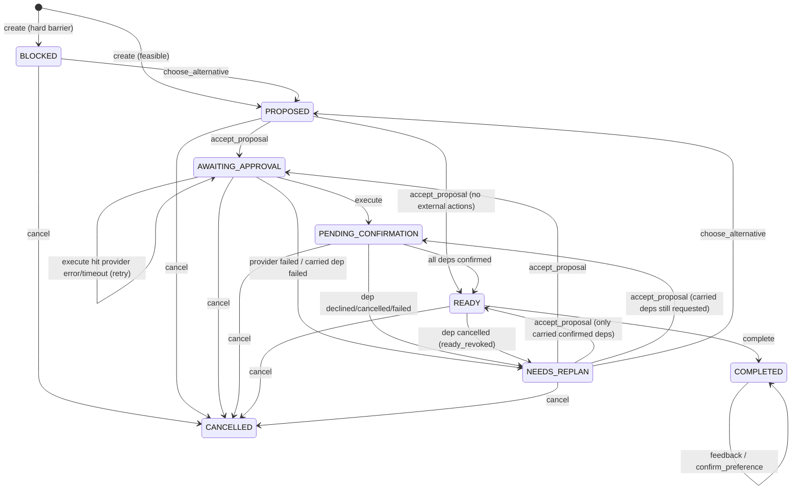

# DayBridge: Coordination Contract v1.0.0

**Status:** implemented and tested on branch `feat/coordination-engine`.
- Plans are stored in memory only.
- Only the **mock provider** exists, so **nothing is ever sent** to a real person or service.
- Zod schemas: the "Coordination contract v1" section of `src/lib/schema.ts`.
- Code: `src/domain/coordination/` (`coordinator.ts` state machine, `planner.ts` interventions, `provider.ts` provider port) and `src/app/api/coordination/`.

Hard barriers come from the existing `checkActivity` in `src/domain/engine.ts`, so `/api/analyze` and coordination always agree on what's feasible. The AI is not involved anywhere in this module.

## 1. Plan states

| State | Meaning | Leaves via |
|---|---|---|
| `BLOCKED` | A hard barrier (time, access, transport, cost) makes the activity infeasible | `choose_alternative` → PROPOSED/BLOCKED; `cancel` |
| `PROPOSED` | Interventions computed; the user hasn't accepted them | `accept_proposal` → AWAITING_APPROVAL (actions need approval) or READY (no external actions); `choose_alternative`; `cancel` |
| `AWAITING_APPROVAL` | Accepted; each external action needs a scoped approval | `approve` / `revoke` (stay); `execute` → PENDING_CONFIRMATION, NEEDS_REPLAN if the provider returned `failed`, or **stays** if any provider call threw/timed out (§4); a carried dependency failing → NEEDS_REPLAN; `cancel` |
| `PENDING_CONFIRMATION` | Approved actions were dispatched; waiting for provider/participant evidence | all dependencies confirmed → READY; any declined/cancelled/failed → NEEDS_REPLAN; `cancel` |
| `READY` | The invariant in §2 holds | `complete` → COMPLETED; dependency cancelled/declined → NEEDS_REPLAN (`plan.ready_revoked`); `cancel` |
| `NEEDS_REPLAN` | A dependency failed; a recovery proposal (or blockers + alternatives) is attached | `accept_proposal` (only if there are no blockers) → AWAITING_APPROVAL, or, with nothing new to send, READY (or PENDING_CONFIRMATION while carried deps are still `requested`); `choose_alternative`; `cancel` |
| `COMPLETED` | The user reported the outcome (`attended`, `source: "self_reported"`) | `feedback`, `confirm_preference`, `reject_preference` only |
| `CANCELLED` | The user ended the plan | nothing; provider events are ignored |



## 2. Invariants (enforced in code and covered by tests)

- **READY** means: no blockers; every current action has `status: "dispatched"` with an `approvalId` pointing to an **unrevoked** approval whose `actionId` and scope match; and every current dependency is `confirmed`. `readyViolations(plan)` returns the reasons it doesn't hold.
- **Requested is not confirmed.** Dispatch sets a dependency to `requested`. Only a provider event sets it to `confirmed`.
- **Approval scope** is `{kind, activityId, recipientId, when, sharedFields}`. `sameScope` requires all five to match; `sharedFields` is compared as a set (sorted JSON), so order doesn't matter. Because `activityId` is part of the scope, an approval or confirmation **never transfers to another activity**. Default shared fields:
  - ride: `name`, `pickupWindow`, `mobility`
  - invite: `name`, `activityName`, `when`
- **Approval expiry:** `expiresAt` must be in the future and at most 24 h away. `execute` re-checks every pending action **atomically**. If any approval is missing, revoked, expired or mismatched, **nothing** is sent, and expired actions go back to `proposed`.
- **Versions:** each replan bumps `plan.version`. Actions that aren't carried over become `superseded`; they no longer count, and their events are ignored.
- **Carry-over:** on replan, a current action with an identical scope carries over (keeping its original `id` and `idempotencyKey`) if its dependency is `confirmed` or `requested` (in flight), or if it is `approved` with `dispatchError: true` (unknown outcome). Nobody already asked is asked again: e.g. a friend's accepted invite survives a ride cancellation and is not re-sent. Everything else needs fresh approval.
- **Settle** runs after `execute`, `accept_proposal` and every applied provider event, in any non-closed state: any failed current dependency (declined/cancelled/failed) → NEEDS_REPLAN; otherwise READY exactly when `readyViolations` is empty.
- **Recovery** and `choose_alternative` keep exclusions: recipients that declined, cancelled or failed are never proposed again in this plan. Ride options are tried in this order: contacts with `canDrive`, then the generic family ride (`recipientId: "family"`), then paratransit. If none is left, the transport blocker becomes hard and `alternatives` are listed.
- **Generic family ride (#28):** when the route needs a family ride (profile `transport` includes `family`, family time ≤ `maxTravelMin`) and no listed contact can drive, the ride action goes to the reserved recipient `"family"` ("Ride from family (you'll arrange it)"). It is still a normal external dependency: scoped approval, mock dispatch, and a `ride.confirmed` event before READY. It is skipped once any `canDrive` contact has declined/cancelled/failed in this plan (that contact *is* the family), so e.g. Dan cancelling still recovers to paratransit. This keeps coordination in agreement with `/api/analyze`: no activity analyze marks feasible comes back BLOCKED at creation. UIs should label `recipientId: "family"` as "Family" (cosmetic only).
- **Companion invite (#28):** the "invite a friend" action never targets the contact who is the ride recipient in the same proposal (nor excluded recipients). If no other contact is left, the social intervention is the `user_step` "Bring a friend for the first visit" (no dependency).
- **Preferences** change only through `confirm_preference`. `feedback` only adds `proposed` patches. A patch whose `from` no longer matches the profile is rejected as stale. Applying a patch bumps `profileVersion`.

## 3. HTTP API

Every response is a `CommandResult`: `{ plan: CoordinationPlan, outcome: "applied"|"duplicate"|"ignored"|"rejected", reason?, events: CoordinationEvent[] }`. The exception is `GET`, which returns `{ plan, events }` with the full log.

Status codes:
- **200** with `outcome: "rejected"`: the request was valid but the plan refused it (logged with its reason). Show `reason` to the user.
- **400**: the body failed schema validation (`{ error: "path: message" }`, including duplicate or reserved contact ids) or the activity is unknown.
- **404**: unknown plan id.
- **403**: the events endpoint is disabled in production.

### Create a plan: `POST /api/coordination/plans`
```json
{ "profile": { "name": "Maya", "interests": ["crafts"], "mobility": "walker",
    "transport": ["bus", "family", "paratransit"], "maxTravelMin": 30, "times": ["afternoon"],
    "budgetPerWeek": 20, "hearingImpaired": false, "prefersSmallGroups": true },
  "activityId": "<id from ACTIVITIES>",
  "contacts": [ { "id": "elaine", "name": "Elaine", "relation": "friend", "canDrive": false },
                { "id": "dan", "name": "Dan", "relation": "son", "canDrive": true } ] }
```
Contacts (max 10): ids must be unique, and `"paratransit"` and `"family"` are reserved; either violation → 400.

→ `plan.state` is `PROPOSED` or `BLOCKED`. Key plan fields:
- `id`, `version`, `profile`, `profileVersion`, `contacts`, `activityId`, `activityName`, `when`
- `blockers[]`, `interventions[]` (`kind: ride|invite|user_step`, `actionId?`)
- `actions[]`: `{id, interventionId, planVersion, scope, description, status: proposed|approved|dispatched|failed|revoked|superseded, approvalId?, idempotencyKey, providerRequestId?, dispatchError?}`
  - `scope`, e.g. `{ "kind": "ride", "activityId": "<plan.activityId>", "recipientId": "dan", "sharedFields": ["name", "pickupWindow", "mobility"], "when": "<plan.when>" }`
  - `dispatchError: true`: the last dispatch attempt threw or timed out (unknown outcome); retry `execute`.
- `dependencies[]`: `{id, actionId, kind, label, status: not_requested|requested|confirmed|declined|cancelled|failed, lastSequence}`
- `approvals[]` (`{id, actionId, scope, approvedBy, approvedAt, expiresAt, revoked}`), `alternatives[]` (`{activityId, name, when}`), `preferencePatches[]`, `outcome?`
- `dataSource: "mock"`, `createdAt`, `updatedAt`

### Read a plan: `GET /api/coordination/plans/:id`
Returns `{ plan, events }`. Each event is `{seq, at, type, actor: user|agent|provider|demo, outcome, reason?, idempotencyKey?, payload}`.

### Send a command: `POST /api/coordination/plans/:id/commands`
```jsonc
{ "type": "accept_proposal" }
{ "type": "approve", "actionId": "<action.id>", "expiresAt": "2026-10-17T20:00:00Z",
  "scope": { "kind": "invite", "activityId": "<plan.activityId>", "recipientId": "elaine",
             "sharedFields": ["name", "activityName", "when"], "when": "<plan.when>" } } // copy action.scope exactly
{ "type": "revoke", "actionId": "<action.id>" }            // only before dispatch
{ "type": "execute" }                                      // dispatch all approved; once dispatched → "duplicate"
{ "type": "choose_alternative", "activityId": "<one of plan.alternatives>" }
{ "type": "complete", "attended": true }                   // READY only
{ "type": "cancel" }                                       // any non-closed state
{ "type": "feedback", "signals": ["too_crowded"] }         // enjoyed | too_crowded | too_far | too_expensive; COMPLETED only
{ "type": "confirm_preference", "patchId": "<patch.id>" }
{ "type": "reject_preference", "patchId": "<patch.id>" }
```
How feedback signals become patches:
- `too_crowded` → `prefersSmallGroups: false → true`
- `too_far` → `maxTravelMin` minus 10 (minimum 5)
- `too_expensive` → `budgetPerWeek` minus 5 (minimum 0)
- `enjoyed` → no patch

### Simulate a provider event: `POST /api/coordination/plans/:id/events` (demo-only)
This endpoint stands in for provider and participant callbacks. It's on in development, and in production it returns 403 unless `DAYBRIDGE_DEMO_EVENTS=1`.
```json
{ "eventId": "ev-1", "idempotencyKey": "cb-1", "requestId": "<action.providerRequestId>",
  "sequence": 1, "type": "ride.confirmed", "actor": "demo" }
```
Allowed `type` values: `invite.accepted|invite.declined|invite.cancelled|ride.confirmed|ride.declined|ride.cancelled`. A `declined` event after `confirmed` is treated as `cancelled`.

## 4. Idempotency and ordering

- **Duplicates:** an event whose `eventId` or `idempotencyKey` was seen before gets `outcome: "duplicate"`, and nothing changes. Only **applied** or **ignored** events burn their `eventId`/`idempotencyKey`; **rejected** events don't, so a forged or mistyped event can't pre-empt the genuine one.
- **Order:** `sequence` must increase for each `requestId`. An event with `sequence <= dependency.lastSequence` gets `"ignored"` (stale or out of order), so a late `confirmed` can't undo a `cancelled`.
- **Final statuses:** `declined`, `cancelled` and `failed` are final for a dependency; later events are ignored.
- **Rejected events:** an unknown `requestId`, or an event type that doesn't match the action kind, gets `"rejected"`.
- **Ignored events:** events for a superseded request, or for a COMPLETED/CANCELLED plan, get `"ignored"`.
- **Dispatch keys:** `action.idempotencyKey === action.id` (`<planId>:v<version>:<kind>:<recipientId>`) and is passed to the provider. Carried-over actions keep their original key. `execute` skips actions already dispatched or failed. Commands for the same plan run one at a time behind a lock.
- **Provider errors:** if any provider call throws or times out (`PROVIDER_TIMEOUT_MS` = 10 s), that action stays `approved` with `dispatchError: true` and a `<kind>.dispatch_error` event is logged. The plan **stays AWAITING_APPROVAL** and does **not** replan, even if another action failed in the same run. The result is `outcome: "rejected"` with the reason "Some actions could not reach the provider; retry execute". Retrying `execute` reuses the same idempotency keys; failed actions are not retried.
- **Provider failures:** `status: "failed"` marks the action and its dependency `failed`, which triggers a replan (once an `execute` completes with no provider errors).
- **Live actions to notify:** actions superseded while live (dispatched, dependency not final) are listed in the `actions.superseded` event's `payload.dispatchedActionsToNotify`. `cancel` lists every live action, including superseded ones, in the `plan.cancelled` event's `payload.dispatchedActionsToNotify`.

## 5. Provider port (for the GLM simulator)

```ts
type DispatchInput = { planId: string; actionId: string; recipientId: string; approvalId: string;
  idempotencyKey: string; sharedFields: string[]; when: string };
type DispatchResult = { requestId: string; status: "requested" | "failed"; reason?: string };
interface ProviderPort {
  readonly dataSource: "mock" | "live";
  sendApprovedInvite(input: DispatchInput): Promise<DispatchResult>;
  requestApprovedRide(input: DispatchInput): Promise<DispatchResult>;
}
```
`createMockProvider({ fail?: (input) => boolean })` records each dispatch in `.calls`, dedupes by `idempotencyKey`, returns `requestId = "mock-<kind>-<idempotencyKey>"`, and never touches the network. A real provider must also dedupe by `idempotencyKey`, since `execute` retries after errors/timeouts.

To build the simulator, inject everything:
```ts
const c = createCoordinator({ provider, now: () => clock, activities: FIXTURES, newId: () => `plan-${++n}` });
await c.create({ profile, activityId, contacts });
await c.command(id, cmd);   // PlanCommand
await c.ingest(id, event);  // ProviderEvent
c.get(id);                  // { plan, events }
```
Also exported: `readyViolations`, `currentActions`, `currentDeps`, `sameScope`, `MAX_APPROVAL_MS` and `PROVIDER_TIMEOUT_MS`. The reference tests are in `src/domain/coordination/coordinator.test.ts` and `invariants.test.ts`, including a seeded random-walk fuzz test of the invariants.

## 6. UI integration (Teammate A)

Golden demo click path:
1. **Create** a plan (profile + activity + 1–2 contacts). Show the `blockers` or the `interventions`.
2. **Accept** the plan (`accept_proposal`) → AWAITING_APPROVAL.
3. For each action, show an approval card: who (`scope.recipientId` → contact name), what (`description`), when (`scope.when`), and **exactly which fields are shared** (`scope.sharedFields`). "Approve" sends `approve` with that same scope (including `activityId`) and an `expiresAt` (for example, now + 1 h).
4. **Send** (`execute`) → PENDING_CONFIRMATION, with dependencies shown as "requested". If the result is `rejected` with "retry execute", show a Retry button.
5. Demo buttons labeled **"Simulate: Elaine accepts"** and **"Simulate: ride confirmed"** post events with `requestId: action.providerRequestId` and `sequence: 1` → READY.
6. **"Simulate: ride cancelled"** (`sequence: 2`) → NEEDS_REPLAN, with READY revoked and a new paratransit ride proposed.
7. Accept → approve the new ride → execute → simulate the ride confirmation → READY again. The invite stays confirmed.
8. **Complete** (`complete`) → feedback "too crowded" → show the patch as "I heard: prefer small groups (was off)" with Confirm/Reject buttons → `confirm_preference`.

What to render:
- a state badge;
- interventions;
- actions with their status;
- dependencies with their status (never show "requested" as booked);
- alternatives (as `choose_alternative` buttons);
- preference patches;
- an event timeline from `events` (type, actor, outcome, reason), with duplicate/ignored/rejected events shown dimmed;
- a **"Simulated providers"** label, because `dataSource` is `"mock"`.

Use `outcome` and `reason` for user feedback rather than HTTP status.

## 7. Known limitations

- The store is in memory on `globalThis`: it's lost on restart and only works on a single instance. It needs a database (the lead's Supabase) to persist.
- Only the mock provider exists; there's no live invite or ride provider. The events endpoint is a demo stand-in for real callbacks.
- **No auth:** anyone with a plan id can send commands or events. That's acceptable for a local demo only.
- Nothing notifies recipients of live actions that were superseded or cancelled; they are only listed in `payload.dispatchedActionsToNotify` (`actions.superseded`, `plan.cancelled`).
- Interventions are limited to ride, invite and user_step. Feedback signals are limited to the four above. There's no free-text feedback; AI extraction could map text to these signals (the lead's area).
- Contacts are trusted input: `canDrive` is self-declared.
