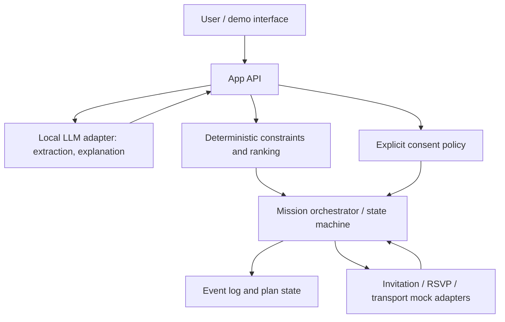

# DayBridge — Reach / Unlock

**DayBridge Reach** is an adaptive participation agent that helps older adults attend activities they actually want to join. **DayBridge Unlock** is the focused hackathon MVP: identify the binding barrier, compute the minimum feasible intervention, coordinate only with permission, recover from disruptions, and learn from confirmed feedback. **DayBridge Collective** (group marketplace / negotiation) is deferred.

## Pitch

> Event apps suggest what you could do. DayBridge finds what's stopping you from actually going — and coordinates the smallest safe change that makes it possible.

## What we are building (P0)

1. Profile of interests, hard constraints, soft preferences, contacts, and permissions.
2. Barrier diagnosis for a proposed activity.
3. Deterministic feasibility checker and minimum-intervention ranker.
4. Explicit consent gate for invitations and transport actions.
5. Mock invitation, RSVP, and ride confirmation adapters with event log.
6. Disruption-driven replanning when an RSVP or ride changes.
7. Feedback → reviewable preference suggestion → confirmation → revised ranking.
8. Accessible demo UI showing state and evidence, plus local inference for structured extraction/explanation.

**Not in MVP:** payments, group negotiation, groceries, medication, voice concierge, broad marketplace or unaudited autonomous messaging.

## Golden demo

Fictional fixture: Maya wants to attend an art workshop, but needs a confirmed ride and prefers a small group. DayBridge diagnoses the blocker, proposes a minimal change, gets approval to invite a friend, registers the RSVP and ride confirmation, and marks the plan READY. When the ride is cancelled, READY is revoked and the agent proposes a new plan. Maya later confirms that she'd prefer smaller groups, updating future ranking.

**Important:** Simulated providers must be visibly labeled. Requested ≠ confirmed, RSVP ≠ verified attendance.

## Proposed stack

Next.js / TypeScript; pure domain and orchestration functions; JSON demo fixtures; Vitest; model adapter for local inference (Ollama or llama.cpp subject to hardware); Zod-style structured outputs; mock provider adapters first. A small durable store such as SQLite is optional. These are suggested implementation choices; validate hardware and environment before committing.

## Architecture

## Required behavior

Plan states: `DRAFT`, `BLOCKED`, `PROPOSED`, `APPROVED`, `COORDINATING`, `READY`, `NEEDS_REPLAN`, `COMPLETED`, `CANCELLED`.

**Rule:** A plan cannot become READY until required dependencies (including transport and required attendees, as applicable) are confirmed; no external message or booking request may be sent without a specific approval.

## Implementation order

1. Scaffold and fixtures; run locally.
2. Implement typed constraints and minimum-intervention ranking, with tests.
3. Implement event log, state machine and approval policy, with tests.
4. Add mock invitation/RSVP/ride adapters and golden end-to-end flow.
5. Add cancellation/replanning and confirmed feedback learning.
6. Add local LLM extraction/explanation behind a replaceable adapter.
7. Build clear demo UI, then rehearse; deploy only on milestone builds.

## Demo quality bar

- Zero hard-constraint violations in fixtures.
- Zero unauthorized external actions.
- `READY` invalidates correctly upon disruption.
- Before/after state and proof are visible to judges.
- Local demo works without live provider services.
- The model may fail without making the deterministic workflow unsafe.

## Where to read next

See **`DayBridge_Product_Engineering_Spec.md`** for the full product requirements, personas, workflows, architecture, API/data contracts, test plan, guardrails, risks, demo script, and coding-agent handoff brief.